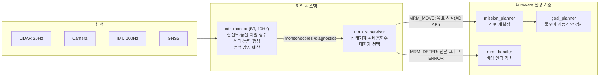
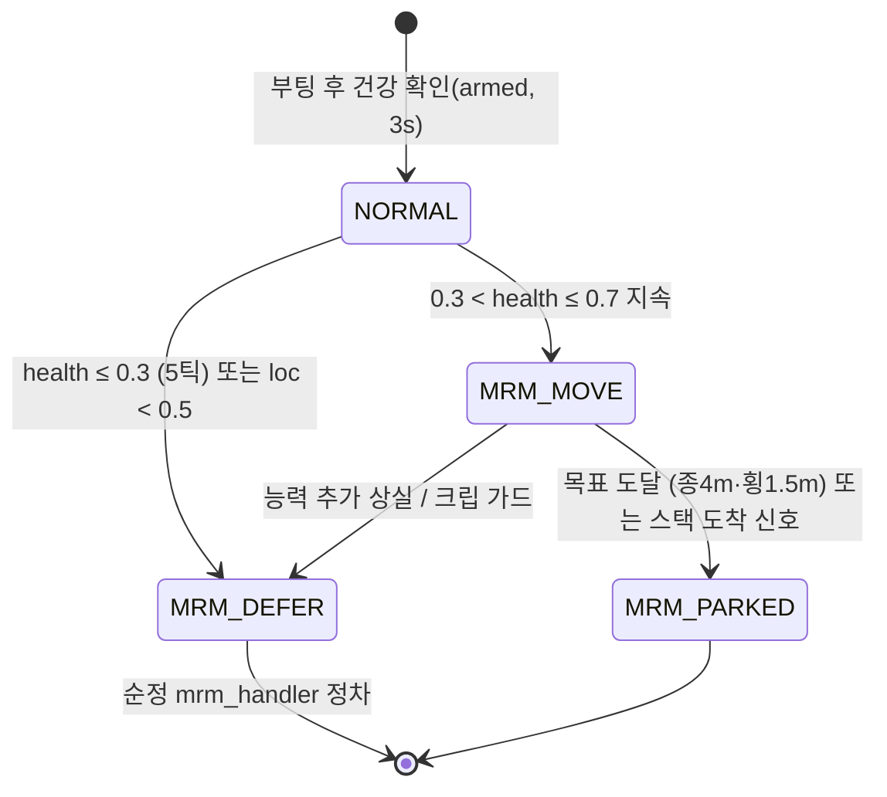

# 행동트리 기반 센서 건강도 감시와 위험·잔여능력 기반 최소위험기동 감독을 통한 자율주행 시스템의 단계적 고장 대응

**Graded Fault Response for Autonomous Driving via Behavior-Tree-based Sensor Health Monitoring and Risk/Capability-aware MRM Supervision**

성균관대학교 일반대학원 (석사학위논문)
저자: (저자명) · 지도교수: (지도교수명)

> 본 문서는 학위논문 제출용 원고(마크다운판)이다. 모든 수치는 실측이며,
> 그림 파일은 `docs/figures/`에, 로우데이터는 `data/`에 있다.
> 연출(staged) 이미지는 캡션에 명시하여 실측과 구분한다.

---

## 국문 초록

자율주행 시스템의 센서 고장 대응은 대부분 "즉시 차로 내 정차"라는 단일
전략에 의존한다. 그러나 차로 내 정차는 그 자체로 2차 위험을 만든다. 본
연구의 실험에서 차로 내 정차 시 후방 차량이 차단된 비율은 70.5%였으며,
공격적 교통에서는 후행 차량이 정차 차량에 0.1m까지 근접하는 위험 추월이
관찰되었다. 본 연구는 고장을 이분법이 아닌 연속 점수로 추정하고, 감지
시간 요구를 주행 위험에 연동하며, 대응을 고장의 종류와 정도에 따라 구분
선택하는 단계적 고장 대응 프레임워크를 제안한다. 제안 시스템은 (1) 센서별
데이터 신선도와 품질을 이원 점수화하고 위험 접근 시 감지 예산을 동적으로
조이는 행동트리 기반 감시 모듈(cdr_monitor)과, (2) 건강도 점수 밴드에 따라
갓길 대피(MRM_MOVE)와 순정 스택 정차 위임(MRM_DEFER)을 구분 선택하는
감독자(mrm_supervisor)로 구성된다. Autoware와 CARLA 시뮬레이터 환경에서
고장 11종, 교통 2종, 짝지은 반복의 자동화 실험으로 평가하였다(설계 실험
계보는 4장; 개발 스모크·프로브를 포함한 총 실행 1,684회, 분석은 각 절에
명시한 유효 케이스 기준). 감지 지연은 지각 고장 1.0~2.8초, 위치계 고장
1.7~2.0초로 일관되었고, 무고장 조건 오경보는 0/96(95% CI 상한 3.1%), 폭우
조건도 0/10이었다.

강한 라이다 노이즈에서 제안 방식은 84%의 갓길 대피 성공률과 차로 점유율
54%에서 21%로의 개선을 달성했으며(McNemar p=4.6×10⁻³³), 위험 도달 시간이
2~3초에 불과한 고장(전방 라이다 상실, 자이로 바이어스)에서는 이동을
억제하고 즉시 정차를 선택하였다. 감시를 비활성화한 무개입 대조 실험에서
측정한 고장별 위험 도달 시간(2~131초)과 잔여 기동 능력(위치·전방 지각
신뢰)의 결합은 제안 시스템의 대피/위임 선택을 일관되게 설명한다: 이동은
"충분한 위험 유예"와 "기동 능력 보존"이 동시에 성립할 때만 선택되었다.
아울러 중간 강도의 지각 노이즈가 강한 노이즈보다 대피를 더 방해하는
비단조 현상, 잔차 기반 위치 감시의 IMU 백색노이즈 사각지대와 바이어스
전용 채널에 의한 보완, 복합 동시 고장에서의 감지 가속과 자동적 보수화를
보고한다.

**주요어**: 자율주행, 기능안전, 최소위험기동(MRM), FTTI, 센서 고장 감지,
행동트리, Autoware, CARLA

---

## Abstract

Sensor-fault handling in autonomous driving stacks largely relies on a
single strategy — an immediate in-lane stop — which itself creates
secondary hazards: in our experiments, in-lane stops blocked following
traffic in 70.5% of observed cases, and aggressive followers passed within
0.1 m of the stopped vehicle. This thesis proposes a graded fault-response
framework that (1) estimates sensor faults as continuous health scores
rather than binary states, (2) couples the detection-time requirement to
the driving risk (time-to-collision), and (3) selects the response —
shoulder pull-over (MRM_MOVE) versus deferral to the stock stop
(MRM_DEFER) — according to fault type and severity. The system comprises a
behavior-tree-based monitor (cdr_monitor) scoring per-sensor freshness and
quality with a risk-coupled dynamic detection budget, and a supervisor
(mrm_supervisor) that selects evacuation targets by cost minimization.
Evaluated on Autoware + CARLA with 11 fault types, two traffic styles, and
paired repetitions (1,684 total executions including development smokes;
per-section valid-case counts), detection latencies were consistent (1.0–
2.8 s perception, 1.7–2.0 s localization), with zero false alarms in 96
fault-free and 10 heavy-rain cases. Under strong LiDAR noise the proposed
method achieved an 84% pull-over success rate and reduced lane occupancy
from 54% to 21% (McNemar p = 4.6×10⁻³³), while for faults whose measured
hazard-onset time is only 2–3 s it suppressed motion and stopped
immediately. Hazard-onset times measured with monitoring disabled (2–131 s
across faults) jointly explain every response choice via two conditions:
sufficient hazard lead time AND preserved maneuvering capability. We
further report a non-monotonic phenomenon in which moderate perception
noise impedes evacuation more than severe noise, a structural blind spot
of residual-based localization monitoring for IMU white noise with a
dedicated bias channel closing the harmful mode, and accelerated,
automatically conservative behavior under simultaneous compound faults.

**Keywords**: autonomous driving, functional safety, minimal risk
maneuver, FTTI, sensor fault detection, behavior tree, Autoware, CARLA

---

## 목차

1. [서론](#제-1-장-서론)
2. [배경 및 관련 연구](#제-2-장-배경-및-관련-연구)
3. [제안 방법](#제-3-장-제안-방법)
4. [실험 설계](#제-4-장-실험-설계)
5. [실험 결과](#제-5-장-실험-결과)
6. [고찰](#제-6-장-고찰)
7. [한계](#제-7-장-한계)
8. [결론](#제-8-장-결론)
- [참고문헌](#참고문헌) · [부록](#부록)

**그림 목차**
- 그림 3-1 시스템 구조 · 그림 3-2 감독자 상태기계 · 그림 3-3 감지 시간축(t0~t5)
- 그림 3-4 대피 후보 지도(수동 주석) 및 주차 후보 예시
- 그림 4-1 Town07 실험 경로와 실측 대피 완료 지점
- 그림 5-1 갓길 대피 완료 장면(실측 좌표 재현) · 그림 5-2 대피 정차의 기하(탑뷰)

**표 목차**
- 표 2-1 기존 연구 계열과 본 연구의 비교 (6축)
- 표 5-1 감지 성능 · 표 5-2 방식 비교 · 표 5-3 단계적 대응 · 표 5-4 무개입 위험 도달 시간
- 표 5-5 동적 예산 ablation · 표 5-6 τ_fresh 민감도 · 표 5-7 안전 부대 지표 · 표 8-1 시간 파라미터 일람

---

## 제 1 장  서론

### 1.1 연구 배경

SAE J3016 기준 4단계 이상의 자율주행 시스템은 운전자의 개입을 전제할 수
없으므로, 시스템 내부에 고장이 발생했을 때 스스로 최소위험상태(Minimal
Risk Condition, MRC)에 도달하는 최소위험기동(Minimal Risk Maneuver, MRM)을
수행해야 한다. 국제 기능안전 표준 ISO 26262는 고장 발생부터 위험 사건까지
허용되는 시간(Fault Tolerant Time Interval, FTTI) 내에 감지와 대응이
완료될 것을 요구하며, 의도된 기능의 안전(SOTIF, ISO 21448)은 센서 성능
한계로 인한 위험까지 관리 범위를 확장한다.

오픈소스 자율주행 스택 Autoware는 comfortable_stop과 emergency_stop을
기본 MRM으로 제공하며, 최근 버전에는 갓길 지향 MRM(pull_over)의 상태와
설정 항목도 존재한다. 그러나 본 연구가 평가한 버전·실행 구성(4.1절)에서
기본 고장 대응 경로는 차로 내 정차였고, 무엇보다 "센서 고장의 종류·정도와
잔여 기동 능력을 평가하여 대피와 정차를 구분 선택하는 감독 계층"은
제공되지 않는다. **본 연구의 기여는 갓길 기동 자체가 아니라 이 감독
계층에 있다.**

차로 내 정차는 구현이 단순하고 즉각적이라는 장점이 있으나, 정차 이후의
상황을 고려하면 그 자체가 새로운 위험원이 된다. 본 연구의 실험에서 차로
내 정차가 발생한 308회의 관찰 중 217회(70.5%)에서 후방 차량의 통행이
차단되었고, 공격적 운전 성향의 교통에서는 후행 차량이 정차 차량 후방
0.1~0.5m까지 근접하는 위험 추월 기동이 빈발했다. 반대로 방어적 교통에서는
후행 차량들이 정차 차량 뒤에 대기 행렬을 형성하여 차단율이 오히려
상승(90%)하였다. 즉 차로 내 정차의 사회적 비용은 교통 성향과 무관하게
존재하며 그 형태만 달라진다.

한편 사람 운전자는 차량에 이상을 느끼면 상황이 허락하는 한 갓길로 차를
빼는 것을 우선한다. 이러한 갓길 대피형 MRM을 자동화하려면 두 가지 판단이
선행되어야 한다. 첫째, 고장이 "갓길까지 이동할 수 있는 정도"인지 "즉시
멈춰야 하는 정도"인지를 구분해야 한다. 둘째, 그 구분은 고장의 종류(어느
센서가, 어떤 방식으로)와 정도(얼마나 심하게)에 대한 연속적 평가를
요구한다. 기존의 이분법적 고장 진단(정상/고장)으로는 이 판단을 내릴 수
없다는 것이 본 연구의 출발점이다.

### 1.2 연구 질문

- **RQ1.** 센서 고장을 연속 점수로 추정하면, 고장의 종류와 정도에 따라
  대응 전략(갓길 대피 vs 즉시 정차)을 차등 선택할 수 있는가?
- **RQ2.** 고장 감지의 시간 요구는 고정 상수가 아니라 주행 위험(충돌까지의
  시간)에 연동되어야 하는가? 연동 시 무엇이 달라지는가?
- **RQ3.** 갓길 대피는 즉시 정차 대비 교통·안전 지표를 실제로 개선하는가?
  어떤 고장 유형에서 유효하며, 한계 조건은 무엇인가?

### 1.3 연구 기여

**첫째**, 행동트리(Behavior Tree) 기반의 센서 감시 모듈을 제안한다. 각
센서에 대해 데이터 신선도(타임아웃)와 데이터 품질(노이즈·유효율)을
독립적으로 점수화하고, 8방향 공간 섹터와 기능 능력(지각·위치) 계층으로
합성한다.

**둘째**, 위험 연동 동적 감지 예산을 제안한다. 감지 마감시간을 고정값이
아니라 min(τ_fresh, TTC)로 두어(반응시간·여유 선차감형은 확장으로 제안),
충돌까지의 시간이 짧아질수록 감지 요구가 자동으로 엄격해진다. 충돌 시간을
측정하는 센서 자신이 불량해진 경우를 위한 최악가정 전파(fail-conservative
hold)를 포함한다.

**셋째**, 위치계 고장의 3채널 감시를 제안한다. GNSS 입력과 EKF 출력의
잔차(노이즈), IMU와 EKF 요레이트의 지속 불일치(바이어스), 입력 침묵의
지수 감쇠(블랙아웃)로 서로 다른 고장 모드를 각각의 채널이 담당한다.

**넷째**, 점수 밴드 기반 MRM 감독자를 제안한다. 건강도가 중간 밴드이면
비용함수로 최적 대피지(갓길·주차장)를 선택해 경로를 변경하고, 바닥
이하이면 순정 스택의 정차에 위임한다.

**다섯째**, 1,313 유효 케이스의 짝지은 자동화 실험으로 위 설계를 검증하고,
감시를 제거한 무개입 실험으로 고장별 위험 도달 시간을 직접 측정하여 대응
선택의 타당성을 독립적으로 입증한다. 실험 과정에서 발견된 비단조 현상,
감시 사각지대, 실행 계층 교착의 원인을 규명하고 개선-재검증 사이클을
완결한다.

본 연구의 신규성은 개별 기법(CUSUM, 잔차 감시, noisy-OR 융합 등 — 각각은
알려진 기술이다)이 아니라, 이들을 연속 건강도로 통합하고 잔여 기동
능력·위험 유예와 결합하여 MRM을 단계적으로 선택하는 **시스템 구조와 그
폐루프 실증**에 있다.

### 1.4 논문의 구성

2장에서 관련 표준과 연구를 정리하고, 3장에서 제안 시스템의 구조와 각
구성요소를 기술한다. 4장은 실험 환경과 설계를, 5장은 결과를, 6장은
고찰을, 7장은 한계를, 8장은 결론을 제시한다.

---

## 제 2 장  배경 및 관련 연구

관련 연구를 여섯 갈래 — 표준·규제(2.1), 시간 예산(2.2), 고장 감지
이론과 센서별 감시(2.3), 폴백·MRM 계획(2.4), 능력 기반 자기감시와 런타임
모니터링(2.5), 시뮬레이션 기반 평가(2.6) — 로 정리하고, 2.7에서 본 연구와
기존 연구를 여섯 개 축으로 비교하는 표를 제시한다.

### 2.1 표준과 규제 프레임

기능안전 표준 ISO 26262[1]는 E/E 시스템 고장의 감지·대응 시간 요구(FTTI)
를 규정하고, SOTIF(ISO 21448)[2]는 고장이 아닌 성능 한계 — 센서 열화,
악천후 — 로 인한 위험까지 관리 범위를 확장한다. SAE J3016[3]은 자동화
수준과 최소위험상태(MRC)·폴백 개념을 정의하며, UNECE R157(ALKS)[4]은
양산 규제로서 MRM의 발동 조건과 거동(감속 정차, 위험 최소화)을 요구한다.
UL 4600[5]과 ISO/TR 4804[6]는 자율주행 안전 사례(safety case)의 구성
요소로 런타임 감시와 열화 대응을 명시한다. AUTOSAR Watchdog Manager[7]는
주기적 alive/deadline supervision 구조를 규정한다(주기는 구성 항목이다).
특히 MRM을 직접 주제로 하는 **ISO 23793-1:2024**[51]는 MRM 유형의 분류
프레임워크와 "상황에 따라 어떤 MRM 유형을 선택할 것인가"의 기본 원칙을
규정하고, 최단순 유형인 직선 정차·차로 내 정차의 요구사항과 시험 절차를
다룬다 — 갓길 정차(road shoulder stop)는 Part 2로 표준화가 진행 중이다.
즉 "고장 상황에 맞는 MRM 유형 선택"은 표준화가 인정하는 문제이며, 본
연구는 그 선택을 센서 건강도·잔여능력으로 구동하는 구체적 방법을
제시한다. 이들 표준은 "무엇이 요구되는가"를 정의하지만, 센서 고장의
종류·정도를 연속적으로 추정해 대응을 구분 선택하는 구체적 방법은
제공하지 않는다 — 본 연구가 다루는 지점이다.

### 2.2 FTTI와 시간 예산의 도출

ISO 26262(2판)는 FTTI를 "고장 발생부터, 안전장치가 작동하지 않는다는 가정
하에 위험 사건이 발생할 수 있는 시점까지의 최소 시간"으로 정의한다.
표준은 구체적 수치를 제공하지 않으며, FTTI는 안전목표별로 차량 동역학과
시나리오에서 도출되어야 한다. Bosch의 산정 방법(US12347247B2)[8]은
차로유지 기능 상실 시나리오에서 차로폭 3.5m, 차폭 1.8m, 속도 120km/h,
곡률반경 1500m 조건의 차로 경계 도달 시간을 시험과 시뮬레이션으로 구해
1.4~1.8초의 FTTI를 도출한 대표 사례이다. 위험도 지표로는 충돌까지의
시간(TTC)[9]과 그 확장형[10]이 표준적으로 쓰이며, RSS[11]는 최악가정
운동학으로 안전 거리를 형식화한다. 본 연구는 FTTI를 감지 시간(FDTI)과
반응 시간(FRTI), 안전여유로 분해하는 프레임을 채택하되, 감시를 비활성화한
무개입 실험으로 고장 유형별 위험 도달 시간을 직접 측정한다(5.3절).
중요한 것은 위험 도달 시간이 고장 유형에 따라 두 자릿수 배율로 달라진다는
점이며(2~131초), 이는 단일 FTTI가 아닌 고장별 예산이 필요함을 시사한다.

### 2.3 고장 감지 이론과 센서별 감시

**고전 FDI 이론.** 동적 시스템의 고장 감지는 Willsky의 초기 서베이[12]
이래 잔차(residual) 생성과 판정의 문제로 정식화되었고, Isermann[13][14]과
Gao 등[15]의 서베이가 모델 기반·신호 기반·지식 기반 계열을 정리한다.
순차 변화 감지는 Page의 CUSUM[16]과 Basseville-Nikiforov의 체계[17]가
고전이며, 본 연구의 라이다 품질 채널은 CUSUM을 차용한다(3.2절). 이들
이론은 "감지"까지를 다루며, 감지 이후의 기동 선택은 범위 밖이다.

**라이다.** 실차용으로는 Autoware의 ring_outlier_filter와
blockage_diag[18]가 인접 포인트 거리 변화와 차폐 영역 진단을 제공하고,
PCL[19]의 Statistical/Radius Outlier Removal은 공간 이웃 통계로 이상점을
판정한다. 악천후 열화의 정량화는 안개 챔버 벤치마크[20], 기상 분류[21],
강우 열화 정량화[22][23]가 다룬다. 본 연구의 라이다 품질 지표는 이들과
원리를 공유하되 목적이 다르다: 이상점의 "제거"가 아니라 센서 상태의
"점수화"이며, 계산량을 실시간 감시 수준으로 억제한 경량 상대 지표이다
(따라서 "상대 거리불연속 점수"로 명명한다, 3.2절). 산업계 라이다
상태감시의 100ms 주기 검사·3회 연속 디바운스 관행은 본 연구의 k-미스
침묵 감지와 정합한다.

**카메라.** Secci와 Ceccarelli[24]는 RGB 카메라의 고장 모드(사망, 노이즈,
블러, 노출 이상 등)를 분류하고 자율주행 지각에 미치는 영향을 분석했다 —
본 연구의 카메라 고장 주입(cn, cf)은 이 분류의 대표 모드에 해당한다.

**IMU.** Allan 분산 기반의 관성센서 노이즈 모델링[25]과 MEMS IMU 등급별
노이즈 평가[26]는 측정 백색노이즈와 시간 누적되는 바이어스 불안정성을
구분해 평가해야 하며, 항법 성능에 실질적 위협이 되는 것은 후자임을
보여준다. 본 연구의 실험 설계(백색노이즈 imn과 바이어스 imb의 분리)와
결과(백색노이즈 미감지·무해, 바이어스 전용 채널 감지)는 이 구분과
정합한다.

**GNSS·측위 무결성.** 도심 멀티패스 오차는 수 m에서 30m에 이르며[27],
도심 GNSS 무결성 감시의 문헌 리뷰[28]와 자율주행 측위 요구사항 분석[29]이
잔차·보호수준 기반 감시의 준거를 제공한다. 본 실험의 주입 강도(1.0/2.5m)
는 보고된 오차 범위의 하단부에 해당하는 현실적 열화이다.

### 2.4 폴백·MRM 계획

고장·성능 한계 시의 안전 정지 계획은 두 흐름이 있다. **궤적 계획
흐름**은 매 계획 주기마다 안전 정지 궤적을 병행 유지(fail-safe motion
planning)[30]하거나, 안전 정지를 최적제어 문제로 정식화[31]하거나,
계획된 궤적을 온라인 검증으로 걸러 사고를 방지한다[32]. 이들은 "어떻게
멈출 것인가"의 기하·동역학을 다루지만, 고장의 종류·정도 평가와 대응
전략의 선택은 전제로 둔다. **폴백 전략 흐름**으로 Emzivat 등[33]은 주행
환경 감시 능력이 손상된 시스템의 동적 주행과업 폴백을 다루며, 감시
불가능 영역에 가상 장애물(ghost object)을 두고 TTC 기반 감속을 수행하는
접근을 제안했다 — 본 연구의 fail-conservative TTC 홀드(충돌 시간 측정원
자신이 불량할 때 마지막 관측 접근속도로 TTC 하한을 감쇠시키는 최악가정
전파)는 이 관점의 연장선에 있다. Reschka와 Maurer[34]는 자동화 차량의
"안전 상태"가 상황 의존적이며 차로 내 정차가 항상 안전하지 않음을
지적했다 — 본 연구의 출발 문제의식과 같다.

**센서 고장 전제형 대피·적응형 MRM — 가장 가까운 선행 연구.** Xue
등[49]은 전방 센서 고장을 전제로, 주변 차량과의 충돌을 MPC 안전 제약으로
회피하며 지정된 안전 주차 구역까지 차로를 이탈·정차하는 폴백을
제안했고(CarSim/Simulink 검증), 후속 연구[50]는 미관측 영역에 가상
차량(virtual vehicle)을 두고 최악 거동을 가정하는 적응형 MPC로 이를
확장했다 — Emzivat의 ghost object[33], 본 연구의 fail-conservative TTC
홀드와 같은 "보수적 가상 위험 모델링" 계보이다. 가장 가까운 연구는 Tang
등[48]으로, 복수 센서 고장 조건에서 HAZOP 기반 위험 분석으로 위험 사건을
식별하고, 가상 객체와 TTC·THW(차두시간) 평가로 MRM 행동(감속, 차로 유지
정차, 갓길 지향 정차 등)을 실시간 적응 선택하며 MATLAB–CARLA 폐루프로
검증했다. 본 연구와의 차이는 다음과 같다. (i) 이들은 **센서 고장 상태가
주어졌다고 전제**하고 그 이후의 기동·선택을 다루는 반면, 본 연구는 센서
데이터의 온라인 감시로 **고장의 발생·종류·심각도 추정부터** 수행한다
(신선도×품질 연속 건강도, 11종 고장 실증). (ii) 선택 기준으로 이들은
주변 교통과의 TTC/THW를 쓰는 반면, 본 연구는 위험 유예에 더해 **잔여
지각·측위 능력**(위치 신뢰, 전방 지각)을 결합한다 — "시간이 있어도
움직일 수 없는" 경우(GNSS 강 노이즈)의 구분은 후자 없이는 불가능하다
(5.3절). (iii) 검증 규모·대상이 다르다: 대표 시나리오 중심의 MATLAB–CARLA
대비, 본 연구는 실제 오픈소스 스택(Autoware) 위에서 1,313 유효 케이스의
짝지은 반복과 무개입 위험시간 대조를 수행했다.

오픈소스 스택 Autoware[18]는 comfortable/emergency stop과, goal_planner를
통한 갓길 pull-over 경로 탐색 기능을 제공한다. 그러나 본 연구가 평가한
커밋·실행 구성(4.1절)에서 센서 건강도와 잔여능력을 평가해 이들 대응을
구분 발동하는 감독 계층은 존재하지 않았다 — 본 연구의 기여는 그 감독
계층이다(1.1절).

### 2.5 능력 기반 자기감시와 런타임 모니터링

Reschka 등[35]의 능력·기술 그래프(ability and skill graphs)는 차량 유도
시스템의 기능 능력을 계층 그래프로 모델링해 온라인 감시와 의사결정에
쓰자는 제안이며, Nolte 등[36]은 이를 개발 프로세스로 확장했다. 본 연구의
섹터·능력 합성(3.3절)은 이 계보의 구체적 구현에 해당하되, 능력 점수를
MRM 등급 선택(대피/위임)과 위험 유예에 직접 결합한 점이 다르다. 런타임
검증 계열로는 자율주행 연구 차량의 런타임 모니터 사례 연구[37], 안전
모니터 합성 프레임워크 SMOF[38]가 있으며, 자율주행 시험·검증의 난제
전반은 Koopman과 Wagner[39]가 정리한다. 행동트리는 로봇 분야의 모듈형
과업 구조로 정착했고[40][41], 본 연구는 BehaviorTree.CPP[42]를 감시
노드의 병렬 구성·실행 추적 구조로 사용한다(알고리즘적 기여가 아니라 구현
구조임을 3.1절에 명시).

### 2.6 시뮬레이션 기반 평가와 고장 주입

CARLA[43]는 센서 모델과 교통 제어를 제공하는 공개 시뮬레이터로 고장 주입
연구의 표준 플랫폼이다. 자율주행 스택 대상 고장 주입으로는 베이지안
최적화로 안전 위반을 효율 탐색하는 DriveFI[44], 오픈소스 주행 에이전트의
레질리언스 평가[45], 시나리오 퍼징 AV-FUZZER[46]가 있고, 시나리오 기술
언어 Scenic[47]이 환경 다양화를 지원한다. 이들은 "고장을 주입해 스택의
취약점을 찾는" 평가 연구로, 주입된 고장을 스택이 스스로 감지·등급화하여
대응을 선택하게 하는 본 연구와 방향이 반대이다(본 연구는 동일 주입
기법을 검증 수단으로 사용한다). 본 연구는 CARLA 0.9.16과 Autoware(main)를
연동하고, 케이스마다 시뮬레이터를 재기동하여 상태 누적을 차단하는 완전
자동화 실험 하네스를 구축하였다(4장).

### 2.7 기존 연구와의 비교

**표 2-1. 기존 연구 계열과 본 연구의 비교**
(○ 명시적 제공 / △ 부분·개념 수준 / × 미취급)

| 연구 계열 (대표 문헌) | 고장 감지 | 연속 건강도 | 위험 연동 시간예산 | 잔여능력 평가 | 단계적 MRM 선택 | 폐루프 실증 |
|---|:-:|:-:|:-:|:-:|:-:|:-:|
| 표준·규제 (ISO 26262, R157, ISO 23793-1 등)[1-7][51] | 요구만 | × | △ (FTTI 개념) | × | △ (MRM 유형 분류) | × |
| 고전 FDI·변화감지 [12-17] | ○ | △ (잔차 크기) | × | × | × | × |
| 센서 열화 정량화 [20-29] | ○ (오프라인) | △ | × | × | × | × |
| Fail-safe 궤적 계획 [30-32] | × (전제) | × | △ (온라인 검증) | × | △ (정지 궤적) | △ |
| 폴백 전략 (Emzivat [33]) | △ | × | ○ (TTC 감속) | △ (감시능력 상실) | △ | × |
| 센서고장 전제형 대피·적응형 MRM (Xue [49][50]; Tang [48]) | × (고장 인지 전제) | × | ○ (TTC/THW) | △ (잔존 센서 활용) | ○ (적응형 선택) | △ (대표 시나리오) |
| 안전상태·능력 기반 자기감시 [34-36] | △ | ○ (능력 수준) | × | ○ (개념) | △ (개념) | × |
| 런타임 안전감시·검증 [37-39] | ○ (규칙 위반) | × | × | × | △ (안전 개입) | △ |
| 순정 Autoware 진단·MRM [18] | △ (타임아웃·범위) | × (이진) | × | × | △ (정차 유형만) | ○ |
| 시뮬레이션·시나리오·고장 주입 평가 [43-47] | × (주입 측) | × | × | × | × | ○ |
| **본 연구** | **○** (11종 실증) | **○** (신선도×품질 이원) | **△/○**¹ (min(τ,TTC)+최악가정) | **○** (위치·지각 신뢰) | **○** (대피/위임 밴드) | **○**² (1,313 유효) |

¹ 구현·발동은 실증했으나 폐루프 종단 이득은 미정량화 — 주장은 "무해성 +
발동 실증"으로 한정한다(5.5절).
² 단일 지도·경로·저속 ODD의 사례 연구이다(7장).

표가 보이듯 각 축을 다룬 연구는 각기 존재한다 — 감지는 FDI, 능력은 skill
graph, 위험 연동 폴백과 적응형 MRM 선택은 Emzivat·Xue·Tang 계열, 정지
기동은 궤적 계획. 특히 Tang 등[48]은 TTC/THW 기반의 적응형 MRM 선택을
폐루프로 보였다. 그러나 이들은 센서 고장 상태를 **전제**로 두며, 센서별
신선도·품질을 온라인 연속 건강도로 추정하고, 고장별 위험 유예와 잔여
지각·측위 능력을 함께 평가하여 대피와 즉시 정차를 구분하며, 이를 실제
자율주행 스택(Autoware) 위에서 대규모 짝지은 반복과 무개입 위험시간
대조로 검증한 연구는 확인하지 못하였다. 본 연구의 위치는 개별 축의 새
알고리즘이 아니라 이 통합 — **감지부터 선택까지의 감독 계층** — 과 그
실증에 있다(1.3절의 신규성 서술과 일치).

---

## 제 3 장  제안 방법

### 3.1 시스템 구조

제안 시스템은 두 개의 독립 노드로 구성된다. 감시 모듈 **cdr_monitor**는
BehaviorTree.CPP 기반의 C++ 노드로(행동트리는 알고리즘적 기여가 아니라
센서별 감시 노드의 병렬 구성·모듈 교체·실행 추적을 위한 구현 구조로
사용한다), 10Hz로 각 센서를 점검하여 점수를 산출하고 /monitor/scores와
/diagnostics로 발행한다. 감독자 **mrm_supervisor**는 Python 노드로, 점수를
구독하여 상태기계를 운용하며, 갓길 대피 시에는 Autoware AD API로 경로를
변경하고, 위임 시에는 진단 그래프를 통해 순정 mrm_handler의 정차를
발동시킨다. 최종 정차 기동의 실행은 Autoware의 goal_planner(풀오버 경로
생성과 안전검사)와 mrm_handler가 담당한다.

**[그림 3-1] 시스템 구조**



수신과 평가의 주기를 분리한 점을 명확히 한다. 센서 콜백은 센서 고유
주기(라이다 20Hz, IMU 100Hz 등)로 데이터를 전부 수신·적산하며, 10Hz는
적산된 증거를 "평가"하는 주기이다. 평가 주기가 기여하는 지연은 최대
0.1초로, 측정된 종단 감지시간(0.75~2.8초)에 포함된 채로 고장별 위험
예산을 충족한다(5.1절). 100ms 평가 주기는 AUTOSAR Watchdog Manager의
주기적 alive/deadline supervision 구조를 참고해 선택한 값이며, Autoware
계획 계층의 판단 주기와도 정합한다.

### 3.2 센서 점수화

각 센서 s에 대해 두 개의 독립 점수를 둔다.

**(1) 신선도 점수.** 마지막 수신 후 경과시간 age(t)에 대해

```
timeout_score = max(0, 1 − age/τ_detect)
```

로 선형 감쇠시킨다. 계단형(마감 도달 시 0)이 아닌 선형 감쇠를 쓰는 이유는
예산이 소진되기 전에 하류의 밴드 경계를 넘을 수 있게 하기 위함이다.
실측에서 카메라 침묵 발생 후 0.45초(마감 850ms의 53%)에 지각능력이 밴드
경계 0.7을 하회했다. 보조 장치로 k-미스 규칙을 둔다: 수신 간격 이동
중앙값의 3배 동안 무수신이면 "의심" 단계로 0.5배 조기 감점한다(산업계
3회 연속 디바운스 관행과 정합).

**(2) 품질 점수.** 라이다는 이웃 포인트 거리차의 평균으로부터 가우시안
가정 하의 표준편차를 복원한다:

```
σ_est = mean(|Δr|) × √π/2,   |Δr| < 1m 표본만 사용
```

(E|r₁−r₂| = 2σ/√π의 역산이며, 1m 초과 차이는 실제 지형 경계이므로
제외한다.) 장면 고유의 거칠기를 흡수하기 위해 부팅 30프레임 동안 기준선을
학습하되, 급격한 상승(1.5배 초과)은 추종하지 않아 고장 자체가 기준선이
되는 것을 막는다. 점수는 exp(−max(0, σ_est − base)/0.1)에 유효(finite)
포인트 비율 점수를 곱한다. 동일 스탬프 메시지의 중복 학습은 배제한다. 이
지표는 절대적 노이즈 추정기가 아니라 기준선 대비 상대 이상 점수이며,
시뮬레이션에서 주입 σ를 복원함을 확인했다. 라이다에는 CUSUM 순차검정(S =
max(0, S + excess − k), S > h 시 강하)을 병행하여 감지 지연이 고장 크기에
반비례하도록 한다. 카메라 품질은 프레임 간 화소 차분으로 동일한 구조를
적용하되, 화소 차분이 주행 중 장면 이동(optical flow)으로 자연 상승하는
속도 종속 신호이므로 누적 검정은 적용하지 않는다(6장의 설계 교훈).

**(3) 위치계 3채널.** 서로 다른 고장 모드를 각각의 채널이 담당한다.

- (a) **잔차 채널**: GNSS 측정과 EKF 출력의 거리 r에 대해
  `loc_meas = exp(−max(0, r − base − 0.2)/0.55)`.
  부팅 시 두 좌표계의 정적 오프셋(~1.4m)을 캘리브레이션한다.
  GNSS 노이즈(측정 오염)에 민감하다.
- (b) **바이어스 채널**: 3초 창의 IMU 요레이트 평균과 EKF 요레이트 평균의
  차이가 0.2rad/s를 3초 이상 지속하면 감점한다. 정상 선회는 두 신호에
  공통으로 나타나 소거되고, 자이로 바이어스는 IMU 쪽에만 남는다.
- (c) **침묵 채널**: 주행 중 GNSS 입력이 1초 이상 끊기면
  `loc_meas ← min(loc_meas, exp(−(stale − 1)/0.8))`
  로 지수 감쇠시킨다. 잔차 채널이 "입력이 없으면 마지막 값에 얼어붙는"
  구조적 사각을 보완한다(블랙아웃 감지 1.9~2.0초 실증).

### 3.3 공간 섹터와 능력 합성

센서 점수는 센서의 장착 방향과 시야에 따라 8방향 섹터(F, FL, FR, L, R,
RL, RR, B)로 사상되고, 섹터 점수는 확률적 보완 형태

```
sector = 1 − Π(1 − s_i)
```

로 융합된다(같은 섹터를 여러 센서가 볼수록 강건). 지각능력은 섹터 가중합

```
perception = Σ w_k · sector_k,   w = {F:0.30, FL/FR:0.15, L/R/B:0.10, RL/RR:0.05}
```

에 장애물 지각과 신호등 관측성을 0.6:0.4로 결합한다. 시스템 건강도는

```
health = min(perception, cap_loc)
```

로, 능력 중 최악을 따른다(약한 고리 법칙). cap_loc은 물리 범위 검사, 위치
점프, 잔차·바이어스·침묵 채널의 최솟값이다.

### 3.4 위험 연동 동적 감지 예산

감지 마감의 구현은

```
τ_detect(t) = min(τ_fresh, TTC_cons(t))
```

이다. 반응시간과 여유를 선차감하는 정식화 min(τ_fresh, TTC − FRTI −
margin)이 개념적으로 더 정확하나, 본 구현·실험은 차감 없는 형태를
사용했으며 차감형은 설계 확장으로 제안한다(7장). τ_fresh는 신선도 채널의
허용시간 상수(본 실험 850ms, 민감도 검증 후 500ms 권고 — 하위 스택
mrm_handler의 가용성 하트비트 0.5초와 정합)이다. **주의: τ_fresh는 시스템
전체의 감지 마감(FDTI)이 아니라 신선도 "점수 감쇠의 시간상수"이며**, 종단
감지시간은 채널 감쇠, 융합·밴드 통과, 감독자 확인을 합한 값이다(5.1절의
시간축 분해). TTC_cons는 최근접 장애물 TTC와 계획경로-예측경로 교차
시간의 최솟값이며, TTC 측정원 센서가 불량하면 ttc_hold(t) = ttc_last −
elapsed로 최악가정 전파한다(2.2절). 열화형(노이즈) 고장의 감지는 통계적
증거 축적이므로 요구를 단일 값이 아닌 심각도 곡선 T_detect(σ) ≤
T_hazard(σ)로 정식화한다: 작은 고장은 늦게 잡히지만 위험해지는 것도 늦다.
백색노이즈 실험(미감지·무해)이 이 정식화의 정합 사례이다(5.4절).

### 3.5 MRM 감독자

**[그림 3-2] 감독자 상태기계**



오발동 방지 장치로 부팅 후 건강 확인(armed, 3초), 경로변경 무응답 워치독,
후보 정체 45초 블랙리스트(대안 후보로 전환), 90초/25m 크립 가드를 둔다.

대피지 선택은 비용 최소화로 한다:

```
J(c) = w_t·η(c) + w_tl·n_tl(c)·g(tl) + w_sec·Σ(1 − sector_req) + w_loc·η(c)·(1 − loc)
```

η(c)는 열화 상태 노출시간(경로시간 + 신호등당 대기 15초)으로, 위험이
거리당이 아니라 시간당 누적된다는 ISO 26262의 관점을 반영한다. 경로시간과
경로상 신호등 수는 지도(lanelet2 파일)를 직접 파싱해 구축한 자체 도로망
그래프에서 다익스트라 탐색으로 산출한다(차선 길이 ÷ 제한속도의 합) —
평가 스택의 계획 계층에 의존하지 않아, 판단 계층이 본체 고장의 영향권
밖에서 동작한다. **신호등 관측성 게이트가 핵심 안전장치이다**: 경로상
신호등을 관측할 수 있는 건강한 카메라가 없으면 해당 후보는 J = ∞로
배제된다. 이 외 하드 제약으로 최소 접근거리 25m, 갓길 최소 길이 7m를
둔다. 가중치의 절대값은 정밀 튜닝을 주장하지 않으며, ±50% 무작위 섭동
800회에서 최상위 후보가 100% 불변임을 확인했다(5.5절) — 후보 간 변별은
게이트와 접근거리가 지배한다.

### 3.6 비교 조건의 통제

baseline 조건은 감지·판단을 제안 시스템과 동일하게 두고 대응만 순정
Autoware MRM(차로 내 정차)으로 위임한다. 순정 진단만으로는 주입 고장
대부분이 감지되지 않아(노이즈 감시 부재) 대응 전략의 효과를 분리할 수
없기 때문이다. "감지 자체가 없는" 시나리오는 무개입(MRM-off) 조건이
별도로 제공한다(4.3절).

### 3.7 MRM 후보 지도 주석 (수동 태깅)

강조할 전제가 있다: **Town07에는 정식 갓길 차선이 존재하지 않는다.** 본
연구의 갓길 후보는 기존 차선을 그대로 표시한 것이 아니라, 최우측 실선과
가드레일·연석 사이에 남는 폭 2.0~2.6m의 잔여 포장 공간을 — 사람 운전자가
갓길이 없는 도로에서 비상 시 차를 우측 구조물에 붙여 대는 관행을 본떠 —
대피 가능 세이프존으로 새로 정의·주석한 것이다. 따라서 본 논문의 대피
결과는 "갓길 차선이 없는 도로에서 잔여 공간만으로 달성 가능한 대피"를
측정한 것이며(5.2절의 점유율 해석과 직결), 정식 갓길 차선이 있는
환경에서의 성능 상한을 보인 것이 아니다.

대피 후보 레이어(갓길 16개소, 주차장 7개소)는 lanelet2 지도에
`road_shoulder` / `parking_lot` 서브타입의 **수동 주석**으로 구축했다.
기준은 (i) 갓길 최소 길이 7m — 시프트 정차 기동의 실측 성공/실패
경계(6.3m 실패, 7.8m 성공)에서 도출, (ii) 본선과의 도로망 연결성, (iii)
주차장은 도로에서 가장 먼 내부 지점을 목표점으로 한다. 수동 주석은 본
연구의 검증 범위를 후보가 주석된 구간으로 한정하며(5.2절 제2경로 결과의
해석에 반영), 확장성 한계와 HD맵 속성 자동 추출 대안은 7장에서 논한다.

**[그림 3-4]** `docs/figures/fig3-4_manual_annotation.png`

> **그림 3-4. 수동 주석 기반 MRM 후보 지도 구성.** (a) Town07 실험 경로와
> 수동 주석된 갓길(16개소)·주차장(7개소) 후보의 전체 분포 및 실측 대피
> 지점. (b) 갓길 후보의 태깅 예: lanelet subtype을 `road_shoulder`로
> 주석하였으며, 본선 lanelet과 경계선(linestring)을 공유하여 도로망
> 연결성이 성립하고 최소 길이 조건(7m)을 충족한다. (c) 주차장 후보의
> 태깅 예: 폐다각형 영역을 `parking_lot`으로 주석하고, 도로에서 가장 먼
> 내부 지점을 대피 목표점으로 둔다. 각 패널의 속성 박스는 lanelet2 지도
> 파일에 기록된 실제 태그이다.

주석 작업은 Vector Map Builder 상에서 수행하였으며, 그림 3-4의 (b), (c)는
그 결과가 저장된 지도 파일을 시각화한 것이다(작업 화면 원본 캡처는 부록에
수록 가능). 갓길 후보는 본선과 경계선을 공유하는 lanelet으로 정의되므로
경로 그래프에서 차선 변경 간선으로 자연 연결되고, 주차장 후보는 폐다각형
영역으로 정의되어 내부 목표점 산출의 대상이 된다. 실험에서 주차장 후보는
갓길 대비 비용이 항상 높아 실제로 선택되지 않았으며(5.2절), 주차장 후보에
차량이 정차한 예시 이미지는 시각화 목적의 연출(staged)로만
제공한다(`docs/figures/parking/`, 파일명에 staged_ 명시).

### 3.8 실행 계층과의 경계 및 인터페이스

본 시스템의 책임 범위는 감지·판단·후보 선택("대피할 것인가, 어디로,
언제")이며, 정차 기동의 실행은 Autoware에 위임한다. 인터페이스는 다음
두 경로이다.

- **MRM_MOVE**: 감독자가 선택한 대피 목표 지점(pose)을 Autoware AD API의
  경로 재설정으로 전달한다. 이후 mission_planner가 목표까지의 차선 경로를
  재계획하고, 목표 부근에서 goal_planner가 풀오버 기동(측방 시프트 경로
  생성, 최종 접근 안전검사)을 수행한다. 즉 갓길 "진입 기동" 자체는 순정
  goal_planner의 기능이며 본 연구는 이를 수정하지 않았다.
- **MRM_DEFER**: 감독자가 진단 그래프(diagnostic_graph_aggregator)에
  ERROR를 주입하면 순정 mrm_handler가 comfortable/emergency stop을
  실행한다.

이 경계 설정은 결과 해석에서 판단 계층의 성능과 실행 계층의 현상(예:
5.4절의 goal_planner 상호 대기 교착)을 구분할 수 있게 하며, 실행 계층
현상을 제안 시스템의 결함과 혼동하지 않게 한다.

**[그림 3-3] 감지 시간축**


본 논문의 "감지 지연"은 t0→t3이며, τ_fresh는 t0→t1 구간의 감쇠 상수일
뿐이다.

---

## 제 4 장  실험 설계

### 4.1 환경

Autoware(main 브랜치, 평가 시점 고정 커밋 — 부록에 해시·컨테이너 이미지
명시)와 CARLA 0.9.16을 자체 C++ 브리지로 연동하고, MRM 구성은 mrm_handler
기본값(comfortable/emergency stop 경로)을 사용했다. CARLA Town07(저속
도심·농촌 혼합 지형)에 갓길·주차장 lanelet을 포함한 자체 벡터맵을
제작하여 사용했다(3.7절). 차량은 리더보드 프레임워크로 기동하며, 경로는
시가지 약 360m(직선-우회전-북상-교차로 2개소 경유)로 고정했다.
시뮬레이터는 케이스마다 재기동하여 장시간 가동 시의 상태 누적(월드 로드
메모리 누수, 동기 모드 고아화)을 차단했고, 모든 케이스의 감시·감독 로그를
gzip으로 전수 보관하여 사후 재판정 분석을 가능하게 했다.

**[그림 4-1]** Town07 실험 경로와 실측 대피 완료 지점:
`docs/figures/overview_map.png`
(회색: 도로망, 초록: 수동 주석 갓길, 주황: 주차장, 파랑: 주행 경로, 별:
캠페인 실측 정차 좌표 4개소)

### 4.2 본 캠페인(시도 880, 유효 845)

고장 7종을 2개 강도(해당 시)로 주입했다: 라이다 가우시안 거리 노이즈
ln(σ=0.3/0.6m), 카메라 화소 노이즈 cn(σ=15/30), IMU 백색노이즈
imn(0.05/0.15rad/s), GNSS 위치 노이즈 gn(1.0/2.5m), 카메라 완전 사망 cf,
전방 라이다 파괴 lf, 무고장 대조 nf. 교통은 공격적(agg: 차간 1.2~1.5m,
제한속도 초과, 고장 후 후방 10m에 추종 차량 유지)과 방어적(def: 차간
2.5m, 규정 준수)의 2종. 각 셀을 20회 반복하고, 제안/기준 두 방식이 동일
셀에서 동일한 교통 시드와 고장 시점을 공유하는 짝지은 설계를 채택했다.
고장 시점은 주행 개시 후 10~45초 구간에서 셀 키로 결정되는 재현 가능한
난수로 추출하여, 고정 시점이 유발하는 공간적 고착(항상 같은 갓길 선택)을
방지하면서 재현성을 유지했다.

### 4.3 보강 실험(시도 305+, 유효 294+)

본 캠페인의 결과와 한계에서 도출된 보강 실험을 수행했다.

- **오탐 게이트**: 개선판(v2) 감지기로 무고장 20회 — 오경보 검사
- **cf/lf 재검증**: 신선도 채널 개선(k-미스) 적용 후 80회
- **현실적 고장 3종**: 자이로 바이어스 imb(0.3/1.0rad/s), 폭우 rain(강수
  90% 프리셋), GNSS 블랙아웃 gb — 문헌의 실제 고장 모드 반영
- **무개입(MRM-off)**: 감시·감독을 제거하고 고장을 방치하여 위험
  사건(차로 내 불능 정지·충돌)까지의 시간 T_hazard를 측정 — 5개 고장 × 5회
- **동적 예산 ablation**: 고정 850ms vs 동적, 개활 조건(ln/cn/gn) 및 근접
  조건(cfl: 선행차 급제동 0.8초 후 카메라 사망) 각 5회
- **τ_fresh 민감도**: 500/850/1000ms 실주행 비교
- **복합 동시 고장 mix**: 라이다+카메라 동시 주입 10회
- **인프라 실패**(시뮬레이터 사망 등 3.9%) 셀 재실행

실험 계보(시도/인프라실패/유효): v1 공격 440/19/421, v1 방어 440/16/424,
v2 배터리 234/10/224, v2 재실행 35/0/35, v2 최종 보강 36/1/35 — 여기에
기제·제2경로·오탐확대(시도 126/실패 4) 및 최종판(v2.1) 오탐 재검증
51/0/51을 더해 **설계 실험 총 시도 1,362, 유효 1,313**이다(개발
스모크·프로브 포함 전체 실행 1,684회). 민감도 재판정은 로그가 보관된 v2
케이스(177개 디렉터리)를 사용했다(v1은 용량 관리상 케이스 로그 미보관 —
재판정 대상에서 제외).

### 4.4 지표와 판정

각 케이스에서 감지 지연(고장 주입→감독자 상태 전환; 판정기 관측치와 로그
스탬프 기반 내부치를 이원 보고), 고장 후 이동거리, 정차 위치와 차로
점유율(차체의 차로 겹침 폭을 점-선분 투영으로 산출), 후방 차량 최소 간격,
정차 후 10초간 후방 통과/차단, 충돌 수, (무개입 조건) T_hazard를
기록했다. 판정은 ROS 토픽 구독 기반의 자동 심판이 수행하고, 정체·미도착
등 예외 상황도 상한 시간과 함께 판정된다.

### 4.5 통계

짝지은 이항 결과는 McNemar 정확검정, 연속 지표는 Wilcoxon 부호순위 검정을
사용했다. 오경보율 0건은 rule of three에 따라 95% 신뢰구간 상한과 함께
보고한다.

---

## 제 5 장  실험 결과

### 5.1 감지 성능

**표 5-1. 고장 유형별 감지 성능 (관측 지연, 초)**

| 고장(강도) | 감지율 | 평균 지연 | 담당 채널 |
|---|---|---|---|
| ln 라이다 노이즈 (0.3/0.6m) | 40/40, 39/40 | 1.0 / 1.0 | 라이다 품질 |
| cn 카메라 노이즈 (15/30) | 39/39, 39/39 | 1.6~2.0 / 1.7~1.9 | 카메라 품질 |
| gn GNSS 노이즈 (1.0/2.5m) | 40/40, 38/38 | 1.8~1.9 / 0.9~1.0 | 잔차 |
| imb 자이로 바이어스 (0.3/1.0rad/s) | 14/14** | 1.9 / 1.8 | 바이어스(v2) |
| gb GNSS 블랙아웃 | 6/6* | 1.9~2.0 | 침묵 감쇠(v2) |
| cf 카메라 사망 | 76/76 | 2.4~2.8 | 신선도 |
| lf 전방 라이다 파괴 | 77/77 | 2.0~2.1 | 신선도 |
| imn IMU 백색노이즈 (0.05/0.15) | 0/40, 23/38 | — / 18.8~34.3 | 사각지대(5.4절) |
| mix 복합 (ln0.3+cn15) | 9/9 | 0.6~0.8 | 융합 가속(v2) |
| nf/rain 대조 | 오경보 0/96, 0/10 | — | — |

\* 감시 수정판 기준(수정 전 4케이스 제외). \*\* 주행 중 주입 기준 — 정지
상태 주입 6건은 미평가(주행 게이트 설계; 정지 중 바이어스는 무해하며
재출발 시 감지됨).

감지 지연은 고장 채널별로 일관된 대역을 형성했다. 복합 동시
고장(라이다+카메라)은 0.6~0.8초로 단독 고장보다 빨랐다 — 섹터 확률 융합과
min() 합성이 동반 하락을 가속 반영한 결과이다.

시간축(그림 3-3)의 관측치와 내부치 구분이 중요하다. 판정기 관측 지연은
상태 발행 주기와 판정 해상도(1초)를 포함한 상한이다. 케이스 로그 스탬프로
산출한 내부 지연은 전방 라이다 파괴에서 평균 0.75초, P95 0.86초, 최대
0.93초였고 카메라 사망에서 평균 1.35초, P95 3.21초였다. 각 값은 해당
고장의 위험 도달 시간(각 3초, 8~55초; 5.3절)보다 작아 고장별 예산을
충족한다. 카메라 사망의 감지 2.4~2.8초는 850ms의 위반이 아니라 t1 이후
융합·확인 구간이 더해진 값이다.

유일한 감지 실패는 IMU 백색노이즈였다(약 0/40, 강 23/38에 평균 19~34초).
이는 잔차 기반 감시의 구조적 사각지대로, 백색노이즈는 EKF의 예측 단계만
흔들고 보정이 계속 당겨와 입력-출력 잔차가 임계(base+0.86m)에 도달하지
않기 때문이다. 동일 케이스들에서 차량은 243~300m를 정상 주행했으므로 이
사각은 심각도 곡선 요구(T_detect(σ) ≤ T_hazard(σ))를 위반하지 않는다.
유해한 IMU 고장 모드인 바이어스는 전용 채널이 1.8초에 감지했다.

오경보는 감지기 버전별로 분리 보고한다: v1 무고장 0/77(95% CI 상한 3.9%),
v2 게이트 0/19, 최종판(v2.1) 재검증 0/50(상한 6.0%), 폭우 0/10 — 무고장
조건 통산 0/146. 개발 중 시뮬레이터 감속 구간에서 벽시계 기준 침묵 판정이
4건의 오탐을 유발했고(시뮬 시간 기준으로 수정 후 0/50 재검증), 이는
시뮬레이션 기반 감시 설계에서 데이터 시계와 벽시계의 분리가 필수임을
보여준다(6장). 폭우 조건은 CARLA의 기상 모델이 센서 데이터 열화를 실차
수준으로 재현하지 않음을 함께 보여주었으며(7장), 화면상 큰 시각
변화(강수 90%, 노면 반사)에도 오경보가 없다는 강건성 결과로 활용한다.

### 5.2 대응 전략의 비교

**표 5-2. 방식 비교 (ours 갓길 대피 성공률 | baseline 후방 차단율)**

| 조건 | ours 성공(agg) | ours 성공(def) | base 차단(agg) | base 차단(def) |
|---|---|---|---|---|
| ln 0.3 | 0/19 | 0/18 | 14/19 | 18/20 |
| ln 0.6 | **16/19 (84%)** | 16/20 (80%) | 6/17 | 3/20 |
| cn 15 | 6/19 | 9/20 | 16/19 | 13/20 |
| cn 30 | 10/20 | 13/19 | 13/19 | 13/20 |
| gn 1.0 | 14/20 (70%) | 16/20 (80%) | 14/19 | 13/19 |
| gn 2.5 | 0 (즉시 위임) | 0 | 14/19 | 13/18 |
| cf | 15/19 (79%) | 8/19 | 17/20 | 15/20 |
| lf | 0 (이동 억제) | 0 | — | — |

성공 시 차로 점유율 17.5~24.8%(평균 21.4%) vs baseline 54%대. baseline
차단 총계 217/308(70.5%).

이동 능력이 보존되는 고장에서 제안 방식은 갓길 대피를 재현성 있게
수행했다. 짝지은 검정(고장 조건 완전 짝 375, 불완전 23 제외)에서 차로
비점유(<40%) 달성의 2×2 분할은 [둘 다 달성 1 / 제안만 128 / 기준만 4 /
둘 다 미달 242]로 **McNemar 정확검정 p=4.6×10⁻³³**, 점유율 차이는
Wilcoxon 부호순위 중앙값 −25.3%p(z=−9.8, p<0.001)였다. 대표 성공률은
구간과 함께 보고한다: 강한 라이다 노이즈 16/19, 84.2%, Wilson 95% CI
[62%, 94%]. 제안 방식의 사고는 라이다 노이즈(중) 조건의 갓길 접근 중
구조물 접촉 3건이 전부였으며, 대피 성공 케이스의 충돌은 0건, 후방 최소
간격은 2.6~18m로 유지되었다.

**[그림 5-1]** 갓길 대피 완료 장면(실측 정차 좌표 재현 촬영):
- (a) `docs/figures/shoulder/caseB_ln_mid_t26_agg_shoulder1002445_d2.4m_rear34.png` — 라이다 노이즈, 주입 26초
- (b) `docs/figures/shoulder/caseA_gn_mid_t45_agg_shoulder1002323_d2.3m_rear34.png` — GNSS 노이즈, 주입 45초
- (c) `docs/figures/shoulder/caseC_ln_high_t45_agg_shoulder1002455_d2.8m_rear34.png` — 라이다 노이즈(강)
- (d) `docs/figures/shoulder/caseD_lf_mid_t36_def_shoulder1002284_d2.9m_rear34.png` — 전방 라이다 상실

**[그림 5-2]** 대피 정차의 기하(탑뷰):
`docs/figures/shoulder/caseB_ln_mid_t26_agg_shoulder1002445_d2.4m_top.png`

점유율 21%의 해석에는 3.7절의 전제가 필수적이다. Town07에는 정식 갓길
차선이 없으며, 대피처는 최우측 실선과 가드레일·연석 사이의 잔여 포장
공간(폭 2.0~2.6m)뿐이다. 차폭(1.9m)과 비슷한 이 공간에 완전 진입하는
것은 물리적으로 불가하고, 실측 정차는 세이프존 중심선에서
2.3~3.7m(차로 걸침 약 1.9m)였다. 즉 **점유율 54%→21%는 "갓길이 없는
도로에서 잔여 공간만으로 얻어낸 감소"**이며, 후행 차량이 통과할 수 있는
폭을 확보했다는 점에 의미가 있다(후방 간격 2.6~18m 유지, 표 5-7). 정식
갓길 차선이 존재하는 ODD라면 동일한 판단 계층으로 점유율을 더 낮출 수
있을 것으로 기대되나, 이는 본 실험 범위 밖이므로 검증하지 않은 기대로
남긴다(7장).

### 5.3 단계적 대응과 위험 시간의 일치

**표 5-3. 단계적 대응 실증 (같은 센서, 강도만 상이)**

| 고장 | 약(mid) | 강(high) |
|---|---|---|
| GNSS 노이즈 | 1.0m → 갓길 대피 70~80% | 2.5m → 즉시 DEFER (감지 1.0s) |
| 라이다 노이즈 | 0.3 → 이동 봉쇄 (0%) | 0.6 → 갓길 84% (**비단조!**) |
| 자이로 바이어스 | 0.3rad/s → DEFER | 1.0rad/s → DEFER (1.8s) |

**표 5-4. 무개입(MRM-off) 위험 도달 시간 — 고장별 FTTI의 실증 도출 (n=5/고장)**

| 고장 | T_hazard min~max (평균) | 시스템 선택 | 일치 |
|---|---|---|---|
| imb 1.0 | 1~2s (2) | 즉시 DEFER | O |
| lf | 3s | 이동 억제→위임 | O |
| ln 0.6 | 5~14s (8) | 신속 대피 (84%) | O |
| cf | 8~55s (36) | 대피 (79%) | O |
| gn 2.5 | 40~131s (82) | (mid에서) 대피, (high) 위임 | O |

전 25케이스 충돌 0 — 위험은 "차로 내 불능 정지"로 발현. T_hazard의
표본 크기(n=5/고장)에 유의한다: 본 논문은 이 값을 분포의 정밀 추정이
아니라 **자릿수 구분**(초 단위 / 십초 단위 / 수십~백초 단위)으로만
사용하며, 대응 선택을 가르는 경계(imb 최대 2s·lf 3s ↔ ln 최소 5s)에서
관측 범위가 겹치지 않음에 근거한다. 예산 비교에는 평균이 아닌 관측
최솟값을 쓴다(보수적). 인증 수준의 FTTI 도출(단일 시나리오에 대한
대규모 시험·시뮬레이션)은 본 연구 범위 밖이다.

MRM_MOVE의 선택은 1차원이 아니라 두 조건의 교집합으로 설명된다:

```
MRM_MOVE 가능 = (충분한 위험 유예) AND (잔여 기동 능력 보존)
```

무개입 실측과 결합하면 네 가지 관찰이 모두 설명된다. (i) 카메라 사망:
유예 김 + 능력 보존(라이다 건재) → 대피 79%. (ii) GNSS 중(1.0m): 유예 김
+ 위치 신뢰 유지 → 대피 70~80%. (iii) GNSS 강(2.5m): 유예는
길지만(40~131초) 위치 신뢰가 이동 최소치 미만 → 즉시 위임 — **시간이
있어도 움직일 수 없는 경우**. (iv) 전방 라이다·자이로 바이어스: 유예
2~3초 + 능력 상실 → 즉시 위임. 즉 밴드·위치 게이트라는 설계는 "유예 ×
능력"의 두 축을 운용 시점에 근사하며, 무개입 실측은 그 근사가 위험 구조와
정합함을 보인다.

### 5.4 발견

**(1) 비단조 현상.** 라이다 노이즈 σ=0.3에서 대피 성공 0%(이동 시도는
하나 유령 장애물이 진로를 봉쇄), σ=0.6에서 84%. 카메라 노이즈에서도
32%→56%로 재현되었다. 관찰된 거동(중간 강도에서 진로 봉쇄형 정지 반복,
강한 강도에서 자유 주행)의 가능한 기제로, 중간 오염은 지각 파이프라인이
수용하는 "그럴듯한 허위 장애물"을 생성하고 강한 오염은 전처리 필터가
이상점으로 기각한다는 해석을 제시한다. 객체 수준 기록(전방 ±60° 원뿔 내
PredictedObjects)에서 중간 강도는 전방 유령 객체 점유율 11~70%(중앙값
2~3개), 강한 강도는 3~10%(중앙값 0~1개)로 이 해석과 정합했다(필터 전후
데이터의 직접 대조는 향후 과제). "중간 고장이 가장 위험하다"는 이 현상은
고장 심각도와 기능 영향이 단조가 아님을 보이며, 정도 기반 차등 대응의
필요성을 강화한다.

**(2) IMU 감시의 사각과 보완.** 5.1절의 백색노이즈 사각은 문헌이 지적하는
실제 위험 모드(바이어스)와 함께 해석되어야 한다: 스펙 노이즈의 30배를
주입해도 EKF가 흡수해 무해했고, 유해한 바이어스는 전용 채널이 감지했다.

**(3) 후방 차단의 형태 반전.** 방어적 교통은 정차 차량 뒤에 대기하여
차단율이 상승했고(라이다 중 조건 74%→90%), 공격적 교통은 0.1~0.5m 근접
추월로 통과했다. 차로 내 정차의 비용은 교통 성향과 무관하게 존재하며
형태만 바뀐다.

**(4) 실행 계층 상호 대기 교착의 규명과 해소.** 무고장 차량조차 교차로
직후에 설정된 목적지에는 도달하지 못했다. 정지 순간의 계획 상태를 포착한
결과(2회 재현) 정지 주체는 신호나 교차로 양보가 아니라 goal_planner였다:
최종 접근 안전검사가 후방 대기 차량을 이유로 기동을 보류하고, 후방 차량은
전방 정차를 이유로 대기하는 상호 대기이다. 목적지 25m 이내 근접 도달
기준으로는 57~63%가 도달했으며, 목적지를 교차로에서 40m 이격한 개입
실험에서 10케이스 중 6건이 목적지 1~2m 이내에 정차 완료되어(잔여 4건은
경유 교차로의 교통 그리드락) 원인의 인과가 확정되었다.

### 5.5 Ablation과 파라미터 민감도

**표 5-5. 동적 감지예산 ablation (ours, agg, 5반복)**

| 고장 | 고정 850ms 감지/성공 | 동적 감지/성공 |
|---|---|---|
| ln mid | 1.1s, 0/4 | 1.1s, 0/5 |
| cn mid | 2.4s, 2/5 | 2.3s, 2/5 |
| gn mid | 1.7s, 5/5 | 1.7s, 4/5 |

개활 조건(고장 시 근접 장애물 부재)은 고정과 동적이 동일했다(차이 ≤0.1초,
성공률 동등) — **동적 조임의 무해성**. 근접 조건은 선행차 급제동과 센서
사망을 결합한 4종의 폐루프 설계(고정 지연 주입, TTC 트리거 0.9/1.8초,
즉석 속도 매칭 스폰)로 시도했다. 조임의 발동 자체는 실증되었으나(마감
<850ms 틱: 동적 15~3,373 vs 고정 0), 종단 이득의 폐루프 측정은 구조적으로
불가함을 확인했다: 건강한 스택의 장애물 정지가 접근 속도를 선제 감쇠시켜
TTC<1초 구간이 자기 소멸하며(계측: 20m 전방 급제동 후에도 TTC 6.4~11.3초
유지), 지각 상실로 스택 제동이 실패하는 조건에서는 조임을 구동할 TTC 측정
자체가 함께 상실된다(해당 경로는 최악가정 전파가 담당). 따라서 동적
예산은 **심층 방어(defense-in-depth) 장치**로 규정한다 — 정상 폐루프에서
무해하고 발동이 실증되었으며, 이득의 정량화는 스택 제동을 배제한 개루프
자극 시험을 요한다(향후 과제). 이 "위험 창의 자기 소멸" 관찰 자체가
폐루프 안전 평가 방법론에 대한 부수 기여이다.

**표 5-6. τ_fresh 민감도 (ours, agg, 5반복)**

| τ_fresh | ln mid 감지/성공 | cf 감지/성공 |
|---|---|---|
| 500ms | 1.1s, 0/4 | 2.9s, 3/5 |
| 850ms | 1.0s, 0/19(v1) | 2.7s, 4/7(v2 agg) |
| 1000ms | 1.1s, 0/5 | 3.0s, 4/5 |

성공률·오경보 불변 → 500ms 권고(mrm_handler 0.5s 하트비트 정합).

파라미터 민감도는 위 실주행 비교에 더해, 보관된 전 케이스 로그의
재판정으로 6종을 확장 검증했다. **밴드 상단 0.7**: 고장 시 지각 점수는
0.42~0.65에, 정상 주행은 0.9 이상에 정착하여 [0.65, 0.9]가 무감
구간이며, 이 구간 내 어느 임계든 판정이 동일하다. 임계를 낮추면 감지가
계단식으로 상실된다(0.6에서 카메라 노이즈 3/6, 0.5에서 카메라 사망
12/40만 도달). **밴드 하단 0.3**: 지각 경로로는 거의 도달하지 않으며(전방
라이다 0/43), 위임은 위치 채널이 전담한다 — "지각 저하는 이동, 위치
붕괴는 정지"라는 역할 분리의 실증. **CUSUM (k,h)**: 3×3 격자 전 영역에서
감지가 유지되었다(재판정 로그 해상도 1초 내 동일 샘플에서 감지 — 임계
위치가 감지 여부를 바꾸지 않음; 1초 미만의 지연 차이는 본 로그 해상도로는
판별하지 않는다). **비용 가중치**: ±50% 무작위 섭동 800회에서 최상위
후보가 100% 불변 — 후보 간 변별은 관측성 게이트와 접근거리가 지배하므로
가중치는 서수적 우선순위의 인코딩으로 충분하다. k-미스 계수와 바이어스
임계는 해석표로 제시한다(부록). 재판정 민감도는 판정 계층(감지
시점·분류)까지를 검증하며, 폐루프 결과의 민감도는 τ_fresh 실주행이
대표한다.

복합 동시 고장(라이다 0.3 + 카메라 15, 9유효)에서는 감지가 0.6~0.8초로
단독보다 빨랐고 대응은 전원 즉시 위임이었다 — 고장이 중첩될수록 시스템이
더 빠르고 더 보수적으로 수렴한다.

**표 5-7. 안전 부대 지표 (v1, 유효 845케이스)**

| 항목 | 값 |
|---|---|
| ours 충돌 | 구조물 접촉 3 (전부 ln 0.3 갓길 접근 중), 차량 충돌 0 |
| 대피 성공 케이스 | 충돌 0, 후방 간격 2.6~18m |
| baseline 후방 최소간격 | 공격 교통에서 0.1~0.5m 빈발 |
| 고장→정지 | baseline 1.6~5.6s(즉시) vs ours 대피 시 이동 11~130m |

---

## 제 6 장  고찰

본 연구의 중심 결과는 시스템의 대응 선택이 "위험 유예 × 잔여 기동 능력"의
2차원으로 일관되게 설명된다는 점이다(5.3절). 밴드 경계와 위치 게이트는
설계 시점에는 휴리스틱이었으나, 무개입 실측과 결합하면 유예가 길고 능력이
보존된 고장에서만 대피가 선택되었고, 유예가 짧거나 능력이 상실된
고장에서는 위임이 선택되었다. 이는 "정도 기반 차등 대응"이라는 설계
원리가 위험의 실제 시간 구조와 정합함을 뜻한다.

시간 예산 논의에서 850ms는 전체 FTTI가 아니라 신선도 채널의 감지
예산이다. 전체 예산은 고장별 위험 도달 시간에서 반응 시간과 여유를 차감해
배분되어야 하며(FDTI 프레임), 실측 내부 지연(전방 라이다 P95 0.86초 <
위험 3초; 카메라 P95 3.21초 < 위험 8초)이 이 배분을 채운다. 열화형 고장의
감지는 증거 축적 시간이므로 "모든 고장 1.5초"가 아니라 "위험해지는
속도만큼 빨리"가 올바른 요구 정식화이며, 백색노이즈의 미감지·무해 사례가
그 정합성을 보여준다.

비단조 현상은 대응 선택의 한계도 드러낸다. 사후적으로 보면 중간 강도
라이다 노이즈(σ=0.3)는 유령 장애물이 이동을 봉쇄하므로 처음부터 위임
(DEFER)이 최적이었다. 그러나 시스템이 감지 시점에 보는 것은 신호 수준
심각도(σ)이고, σ=0.3은 σ=0.6보다 "덜 심한" 고장이므로 이 역전을 신호
기반 임계 조정으로는 인코딩할 수 없다 — 바닥 임계를 올리면 대피가 잘
되는 강한 노이즈까지 함께 위임되어 단계적 대응 자체가 소거된다. 현재
구현은 이를 2차 방어로 흡수한다: 후보 정체 45초 블랙리스트가 대안 후보로
전환하고, 크립 가드(90초/25m)가 진전 없는 MRM_MOVE를 DEFER로 강제
전이시킨다 — 다만 사후 대응이므로 지연과 저속 접근 중 구조물 접촉
3건의 비용을 치렀다. 선제화의 올바른 방향은 임계가 아니라 기능 영향
채널이다: 하류 지각 출력에서 전방 근접 객체의 비정상 급증을, 건강한
이종 센서(카메라)와의 불일치로 검증하는 채널을 추가하면 중간 강도
노이즈를 감지 즉시 위임으로 보낼 수 있다(향후 과제).

원신호 감시의 설계 교훈도 기록한다. 부팅 정지 상태에서 학습한 기준선에
속도 종속 신호(IMU 진동 분산, 카메라 화소 차분)를 비교하거나 누적 검정을
결합하면 구조적 오탐이 발생했다(개발 중 3건 실측·수정). 반면 속도와
무관한 기하 기반 신호(라이다 σ)에서는 누적 검정이 안정적으로 동작했다.
"누적 검정은 속도 독립 신호에만"이라는 이 관찰은 원신호 기반 차량 감시
설계 일반에 적용될 수 있다. 같은 계열의 교훈으로, 침묵 판정의 기준 시계는
벽시계가 아니라 데이터(시뮬) 시계여야 한다 — 시뮬레이터 감속 구간에서
벽시계 판정이 정상 공백을 침묵으로 오인했다(수정 후 0/50 재검증).

신호등 관측성 게이트는 카메라 계열 고장에서 대피 성공률을 낮추는 주요
요인이었다(후보 급감). 이는 "신호를 읽지 못하는 차량을 신호 교차로에
보내지 않는다"는 의도된 보수성의 비용이며, 신호등 없는 우회 경로 탐색으로
완화 가능하다(향후 과제).

실행 계층 교착(5.4(4))은 판단 계층과 실행 계층의 경계 설정(3.8절)이
분석에 유효했음을 보여준다. 교착의 원인은 제안 시스템이 아니라 스택
goal_planner의 최종 접근 안전검사와 후방 대기 차량의 상호 대기였고,
목적지 배치 개입으로 인과가 확정되었다. 동시에 이는 갓길 대피형 MRM을
실용화할 때 실행 계층의 정체 감지·재계획이 함께 요구됨을 시사한다.

---

## 제 7 장  한계

본 연구의 수치 결과는 단일 지도(Town07), 단일 경로(약 360m), 저속 도심
ODD의 사례 연구이다. 대피 성공률·점유율 등의 수치는 해당 ODD에 한정되며,
고속 환경(1초 감지가 28m 주행에 해당하는 100km/h 등)은 검증되지 않았다.
일반화 가능한 주장은 수치가 아니라 메커니즘 — 비단조 현상, 채널별 감지
경로, 위험 유예와 대응 선택의 대응 관계 — 로 한정한다.

안전성의 정량 비교에도 한계가 있다. 제안 방식은 고장 상태에서 수십 m를
추가 주행하며, 충돌 0건(유효 845케이스)이 "위험 증가 없음"의 증명은
아니다(희귀 사건). 특히 강한 라이다 노이즈에서의 대피는 장애물 지각이
열화된 상태의 이동이다 — 객체 기록에서 전방 객체 중앙값이 0~1개로,
필터가 노이즈와 함께 실제 객체의 반사점도 기각한다. 대피 중 무충돌은
저속·단거리(11~130m)·협조적 교통이 결합된 관찰 결과이지 장애물 회피
능력 보존의 증거가 아니며, 이동의 정당화 근거는 지각이 아니라 "위험
유예(방치 시에도 5~14초 내 차로 내 불능 정지)와 위치 신뢰의 보존"이다.
같은 논리로 전방 지각이 완전 상실된 lf에서는 이동을 금지했다. 본 논문은 안전성 우위를 주장하지 않고
트레이드오프(노출 증가 vs 차단·근접 위험 해소)를 계량 제시하는 입장을
취한다.

구현 측면에서 IMU 진동 분산 채널과 카메라 누적 검정은 속도 종속성으로
비활성화되었고(6장), 속도 구간별 기준선은 향후 과제이다. 감지 예산의
구현은 min(τ_fresh, TTC)이며 반응시간 선차감형(min(τ_fresh, TTC − FRTI −
margin))은 제안에 머문다. 수동 지도 주석(3.7절)은 확장성 제약이 있으며
후보 미주석 구간에서는 대피가 원천 불가하다 — 제2경로 실험에서 감지는
재현되었으나 대피 성공은 후보 커버리지에 종속됨을 확인했다. HD맵 속성
자동 추출로 대체되어야 한다. Town07에는 정식 갓길 차선이 없어 대피처를
잔여 포장 공간(폭 2.0~2.6m)으로 정의했으므로 "완전 차로 이탈"은
물리적으로 불가하며, 개선은 점유율 감소(54%→21%)로 계량된다(3.7절,
그림 5-2). 이는 한계인 동시에 조건의 명시이다 — 정식 갓길이 있는
환경에서의 점유율 하한은 본 실험으로 결정되지 않는다. 시뮬레이터 한계로 폭우의 센서 열화가 재현되지 않았고,
무결점 오도메트리로 인해 GNSS 상실 시의 관성 유지 시간이 실차보다 길게
측정되었을 수 있다. 판정 해상도(1초)는 내부 로그 병행 보고로 완화했다.
무고장 대조군의 완전 도착률은 실행 계층 교착으로 본 캠페인에서 측정하지
못했고(근접 도달 57~63%), 목적지 이격 검증(6/10 완전 도착)으로 보완했다.
인프라 실패(시뮬레이터 사망 등)는 전체의 약 4%였으며 재실행으로 보충했다.

---

## 제 8 장  결론

본 연구는 센서 고장을 연속 점수로 다루고, 감지 시간 요구를 주행 위험에
연동하며, 대응을 고장의 종류와 정도에 따라 구분 선택하는 단계적 MRM
프레임워크를 제안하고, 단일 ODD 사례 연구로서 유효 1,313케이스의 짝지은
자동화 실험으로 검증했다. **갓길 대피는 만능이 아니다** — 위험 유예가 긴
고장에서는 45~84%의 대피 성공과 차로 점유 54%→21%의 개선을 제공하고,
위험 유예가 짧거나 잔여 기동 능력(위치·전방 지각 신뢰)이 상실된
고장에서는 이동을 포기하는 것이 옳으며, 제안 시스템의 구분은 무개입
실측의 "유예 × 능력" 구조와 일관되게 설명되었다. 연구 과정에서 발견된
비단조 현상, 감시 사각지대, 실행 계층 교착은 각각 원인 규명과 개선,
재검증의 사이클로 종결되었으며, 이 정량적 구획과 개선 이력 전체가 갓길
대피형 MRM의 실용화에 필요한 판단 근거를 제공한다.

향후 과제는 속도 구간별 원신호 기준선, 고속 ODD 검증, 신호등 없는 우회
경로 탐색, 실행 계층 정체 재계획, HD맵 후보 자동 추출, 감지 예산의
반응시간 선차감형 구현, 실차 검증이다.

---

## 참고문헌

**표준·규제**

1. ISO 26262:2018, *Road vehicles — Functional safety*.
2. ISO 21448:2022, *Road vehicles — Safety of the intended functionality*.
3. SAE J3016_202104, *Taxonomy and Definitions for Terms Related to
   Driving Automation Systems for On-Road Motor Vehicles*, 2021.
4. UNECE Regulation No. 157, *Uniform provisions concerning the approval
   of vehicles with regard to Automated Lane Keeping Systems (ALKS)*, 2021.
5. UL 4600, *Standard for Safety for the Evaluation of Autonomous
   Products*, 3rd ed., 2023.
6. ISO/TR 4804:2020, *Road vehicles — Safety and cybersecurity for
   automated driving systems — Design, verification and validation*.
7. AUTOSAR, *Specification of Watchdog Manager*, R23-11.

**시간 예산·위험 지표**

8. Robert Bosch GmbH, "Method and apparatus for determining fault
   tolerant time interval (FTTI) of autonomous driving assistance
   system," U.S. Patent US12347247B2.
9. J. C. Hayward, "Near-miss determination through use of a scale of
   danger," *Highway Research Record*, no. 384, 1972.
10. M. M. Minderhoud and P. H. L. Bovy, "Extended time-to-collision
    measures for road traffic safety assessment," *Accident Analysis &
    Prevention*, 33(1), 2001.
11. S. Shalev-Shwartz, S. Shammah, and A. Shashua, "On a formal model of
    safe and scalable self-driving cars," arXiv:1708.06374, 2017.

**고장 감지 이론**

12. A. S. Willsky, "A survey of design methods for failure detection in
    dynamic systems," *Automatica*, 12(6), 1976.
13. R. Isermann, "Model-based fault-detection and diagnosis — status and
    applications," *Annual Reviews in Control*, 29(1), 2005.
14. R. Isermann, *Fault-Diagnosis Systems: An Introduction from Fault
    Detection to Fault Tolerance*, Springer, 2006.
15. Z. Gao, C. Cecati, and S. X. Ding, "A survey of fault diagnosis and
    fault-tolerant techniques — Part I: Fault diagnosis with model-based
    and signal-based approaches," *IEEE Trans. Industrial Electronics*,
    62(6), pp. 3757–3767, 2015; "— Part II: Fault diagnosis with
    knowledge-based and hybrid/active approaches," 62(6), pp. 3768–3774,
    2015. (제출본에서는 두 항목으로 분리)
16. E. S. Page, "Continuous inspection schemes," *Biometrika*, 41(1/2),
    1954.
17. M. Basseville and I. V. Nikiforov, *Detection of Abrupt Changes:
    Theory and Application*, Prentice Hall, 1993.

**센서별 감시·열화**

18. Autoware Foundation, autoware.universe 패키지 문서: ring_outlier_filter,
    blockage_diag, mrm_handler, goal_planner (autowarefoundation/autoware.universe,
    평가 커밋은 부록 C에 명시). https://autowarefoundation.github.io/autoware.universe/
19. R. B. Rusu and S. Cousins, "3D is here: Point Cloud Library (PCL),"
    *IEEE ICRA*, 2011.
20. M. Bijelic, T. Gruber, and W. Ritter, "A benchmark for lidar sensors
    in fog: Is detection breaking down?" *IEEE Intelligent Vehicles
    Symposium*, 2018.
21. R. Heinzler, P. Schindler, J. Seekircher, W. Ritter, and W. Stork,
    "Weather influence and classification with automotive lidar
    sensors," *IEEE Intelligent Vehicles Symposium*, 2019.
22. C. Zhang et al., "LiDAR degradation quantification for autonomous
    driving in rain," *IEEE/RSJ IROS*, 2021.
    doi:10.1109/IROS51168.2021.9636694.
23. J. Kim, B.-j. Park, and J. Kim, "Empirical analysis of autonomous
    vehicle's LiDAR detection performance degradation for actual road
    driving in rain and fog," *Sensors*, 23(6), 2972, 2023.
24. F. Secci and A. Ceccarelli, "On failures of RGB cameras and their
    effects in autonomous driving applications," *IEEE ISSRE*, 2020.
25. N. El-Sheimy, H. Hou, and X. Niu, "Analysis and modeling of inertial
    sensors using Allan variance," *IEEE Transactions on Instrumentation
    and Measurement*, 57(1), 2008.
26. V. Suvorkin, M. Garcia-Fernandez, G. González-Casado, M. Li, and
    A. Rovira-Garcia, "Assessment of noise of MEMS IMU sensors of
    different grades for GNSS/IMU navigation," *Sensors*, 24(6), 1953,
    2024.
27. S. Khanafseh, B. Kujur, M. Joerger, T. Walter, S. Pullen, J. Blanch
    et al., "GNSS multipath error modeling for automotive applications,"
    *Proc. ION GNSS+*, 2018.
28. N. Zhu, J. Marais, D. Bétaille, and M. Berbineau, "GNSS position
    integrity in urban environments: A review of literature," *IEEE
    Transactions on Intelligent Transportation Systems*, 19(9), 2018.
29. T. G. R. Reid et al., "Localization requirements for autonomous
    vehicles," *SAE International Journal of Connected and Automated
    Vehicles*, 2(3), 2019.

**폴백·MRM 계획**

30. S. Magdici and M. Althoff, "Fail-safe motion planning of autonomous
    vehicles," *IEEE ITSC*, 2016.
31. L. Svensson et al., "Safe stop trajectory planning for highly
    automated vehicles: An optimal control problem formulation," *IEEE
    Intelligent Vehicles Symposium*, 2018.
32. C. Pek, S. Manzinger, M. Koschi, and M. Althoff, "Using online
    verification to prevent autonomous vehicles from causing accidents,"
    *Nature Machine Intelligence*, 2, 2020.
33. Y. Emzivat, J. Ibanez-Guzman, P. Martinet, and O. H. Roux, "Dynamic
    driving task fallback for an automated driving system whose ability
    to monitor the driving environment has been compromised," *IEEE
    Intelligent Vehicles Symposium*, 2017.
34. A. Reschka and M. Maurer, "Conditions for a safe state of automated
    road vehicles," *it — Information Technology*, 57(4), 2015.

**능력 기반 자기감시·런타임 모니터링**

35. A. Reschka, G. Bagschik, S. Ulbrich, M. Nolte, and M. Maurer,
    "Ability and skill graphs for system modeling, online monitoring,
    and decision support for vehicle guidance systems," *IEEE
    Intelligent Vehicles Symposium*, 2015.
36. M. Nolte, G. Bagschik, I. Jatzkowski, T. Stolte, A. Reschka, and
    M. Maurer, "Towards a skill- and ability-based development process
    for self-aware automated road vehicles," *IEEE ITSC*, 2017.
37. A. Kane, O. Chowdhury, A. Datta, and P. Koopman, "A case study on
    runtime monitoring of an autonomous research vehicle (ARV) system,"
    *Runtime Verification (RV)*, 2015.
38. M. Machin, J. Guiochet, H. Waeselynck, J.-P. Blanquart, M. Roy, and
    L. Masson, "SMOF: A safety monitoring framework for autonomous
    systems," *IEEE Transactions on Systems, Man, and Cybernetics:
    Systems*, 48(5), 2018.
39. P. Koopman and M. Wagner, "Challenges in autonomous vehicle testing
    and validation," *SAE International Journal of Transportation
    Safety*, 4(1), 2016.
40. M. Colledanchise and P. Ögren, *Behavior Trees in Robotics and AI:
    An Introduction*, CRC Press, 2018.
41. M. Iovino, E. Scukins, J. Styrud, P. Ögren, and C. Smith, "A survey
    of behavior trees in robotics and AI," *Robotics and Autonomous
    Systems*, 154, 2022.
42. D. Faconti, BehaviorTree.CPP (v4) / behaviortree_ros2, 소스 저장소:
    github.com/BehaviorTree/BehaviorTree.CPP (사용 버전은 부록 C에 명시).

**시뮬레이션 평가·고장 주입**

43. A. Dosovitskiy, G. Ros, F. Codevilla, A. López, and V. Koltun,
    "CARLA: An open urban driving simulator," *Conference on Robot
    Learning (CoRL)*, 2017.
44. S. Jha et al., "ML-based fault injection for autonomous vehicles: A
    case for Bayesian fault injection," *IEEE/IFIP DSN*, 2019.
45. S. H. Rubaiyat, Y. Qin, and H. Alemzadeh, "Experimental resilience
    assessment of an open-source driving agent," *IEEE PRDC*, 2018.
46. G. Li et al., "AV-FUZZER: Finding safety violations in autonomous
    driving systems," *IEEE ISSRE*, 2020.
47. D. J. Fremont et al., "Scenic: A language for scenario specification
    and scene generation," *ACM PLDI*, 2019.

**센서 고장 전제형 대피·적응형 MRM (2.4절 최근접 선행)**

48. J. Tang, C. Yang, and H. Nishimura, "Minimum risk maneuver strategy
    for automated driving system under multiple conditions of sensor
    failure," *Systems*, 14(1), 87, 2026.
49. W. Xue, B. Yang, T. Kaizuka, and K. Nakano, "A fallback approach for
    an automated vehicle encountering sensor failure in monitoring
    environment," *IEEE Intelligent Vehicles Symposium*, 2018.
    doi:10.1109/IVS.2018.8500392.
50. W. Xue, B. Yang, T. Kaizuka, and K. Nakano, "An adaptive model
    predictive approach for automated vehicle control in fallback
    procedure based on virtual vehicle scheme," *Journal of Intelligent
    and Connected Vehicles*, 2(2), pp. 67–77, 2019.
51. ISO 23793-1:2024, *Intelligent transport systems — Minimal risk
    manoeuvre (MRM) for automated driving — Part 1: Framework,
    straight-stop and in-lane stop*. (Part 2: Road shoulder stop — 개발 중)

> 서지 번호는 초고 기준이며, 제출본에서는 인용 순서로 재번호하고 전
> 항목에 DOI·페이지를 통일 기입한다.

---

## 부록

### A. 시간 파라미터 일람 (표 8-1)

| 파라미터 | 값 |
|---|---|
| τ_fresh 신선도 예산 | 850ms(실험) / 500ms(권고) |
| FTTI 상한(총예산) | 1.5s (표 5-4 도출과 정합) |
| BT/감독자 틱 | 100ms (AUTOSAR 주기적 supervision 구조 참고) |
| DEFER 확정(floor) | 5틱 = 0.5s |
| 바이어스/침묵 지속 조건 | 3s / 1s+감쇠 |
| Autoware 가용성 하트비트 | 0.5s / 진단 유닛 timeout 3.0s(CARLA 완화) |
| 케이스 상한 | 6분 / 후보 정체 45s / 크립 90s·25m |

### B. 비용함수 파라미터와 근거

| 항 | 가중치 | 성격 |
|---|---|---|
| w_time (노출시간) | 7 | 서수적 우선순위 인코딩 |
| w_tl (신호등×카메라 열화) | 200 | 〃 |
| w_sector (필요 센서 결손) | 500 | 〃 (결손 1개 > 현실적 시간차) |
| w_loc (위치불신×시간) | 14 | 〃 |
| 관측성 게이트 / 25m / 7m | J=∞ | 하드 안전 제약 (변별의 실질 주체) |

±50% 무작위 섭동 800회(8 지점 × 2 고장 프로파일 × 50)에서 최상위 후보
100% 불변. 안전 필수 조건은 가중치가 아니라 게이트가 담당한다.

### C. 데이터·코드 가용성

- 코드: github.com/utsi09/fs_failsafe (master=v1, v2=개선판, beginner=주석 학습판)
- 로우데이터: `data/results_*.csv` 152개 (열 정의는 data/README.md),
  케이스 로그 gzip 전수 보관(v2), 내부 지연 아카이브, TTC/FTTI 시계열
- Autoware 커밋 해시·컨테이너 이미지: (제출 시 기입)
- 그림: `docs/figures/` — 실측 재현 촬영(shoulder/)과 연출(parking/staged_*)을
  파일명으로 구분

### D. 그림 파일 매핑

| 그림 | 파일 | 성격 |
|---|---|---|
| 3-1, 3-2, 3-3 | 본문 mermaid (제출 시 벡터 도식으로 재작성) | 도식 |
| 3-4 | figures/fig3-4_manual_annotation.png (3패널: 전체/갓길/주차장, 실제 지도 태그) | 실측 지도 데이터 |
| (참고) | figures/parking/staged_*.png — 주차 후보 위치의 차량 배치 예 | **연출** |
| 4-1 | figures/overview_map.png | 실측 좌표 |
| 5-1(a~d) | figures/shoulder/case{B,A,C,D}_*_rear34.png | 실측 좌표 재현 |
| 5-2 | figures/shoulder/caseB_*_top.png | 실측 좌표 재현 |
